# Skywire for Android: user guide

The Skywire app runs a full Skywire node (a visor) on your phone, together
with the apps that use it: SkyVPN, SkyDNS, SkyChat, SkySOCKS, SkyDEX and a
multi-coin wallet. This guide walks through each screen. For building the app
yourself, see [android/README.md](https://github.com/skycoin/skywire/blob/develop/android/README.md).

The screenshots are from the Android 16 emulator.

## Install

Download `skywire-<version>-android.apk` from the
[latest release](https://github.com/skycoin/skywire/releases/latest) and open
it on the phone. Android asks once to allow installs from the browser or file
manager you opened it with. The release also has a `.sha256` file to check the
download against.

## Connect

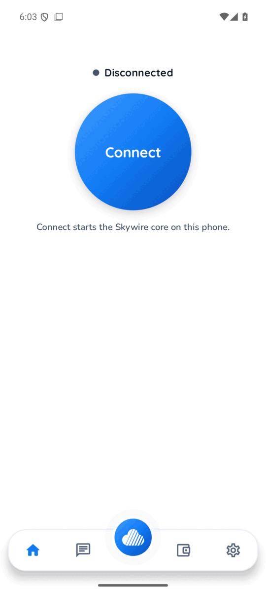

The home screen has one button. **Connect** starts the Skywire core on the
phone; **Disconnect** stops it.

On the first connect Android asks whether Skywire may send notifications.
Allow it: the core runs as a foreground service, and its notification is what
keeps it running while the app is closed.

 

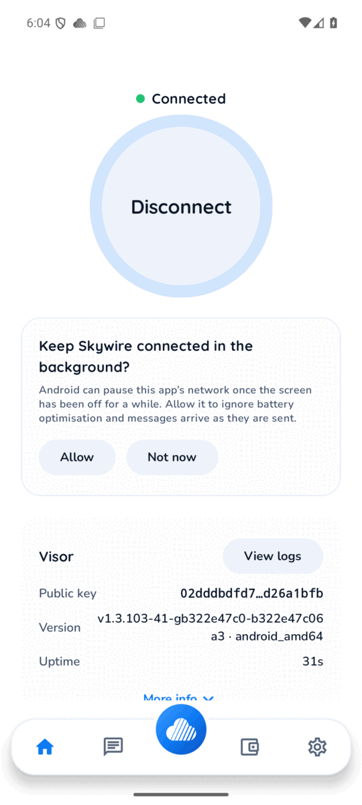

Once connected the screen shows the visor: its public key, which is this
phone's address on the network, its version and how long it has been up.
**View logs** opens the core's log, the first place to look when something
does not work.

The app also offers to ignore battery optimisation. Without it Android can
pause the app's network some time after the screen goes off, and messages and
calls then arrive late. **Allow** opens Android's setting; **Not now** asks
again later. The same choice is under Settings, Battery.

 

## Apps

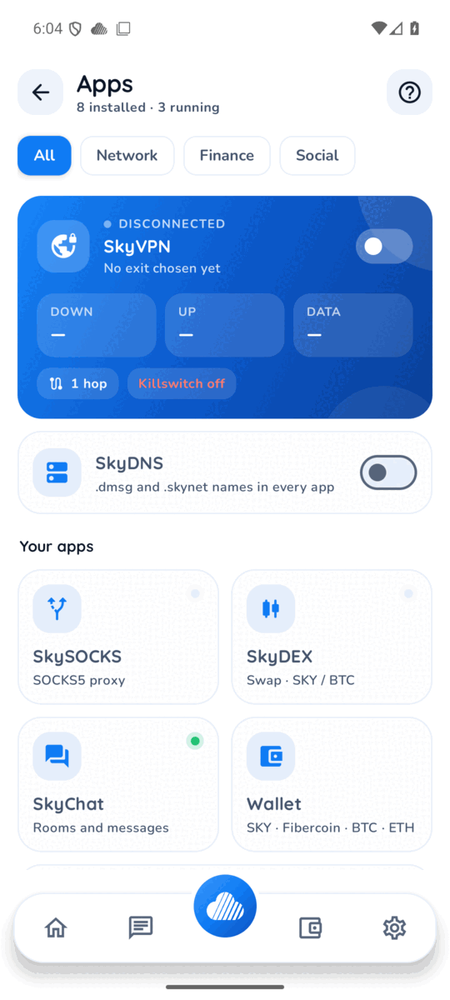

The round button in the middle of the bottom bar opens the Apps hub. SkyVPN is
on top, with its traffic counters, route length and killswitch state. Below it
is the SkyDNS switch, then the other apps. A green dot marks an app that is
running. The chips at the top filter the list.

 

## SkyVPN

SkyVPN routes the phone's traffic through a Skywire VPN server (an exit).

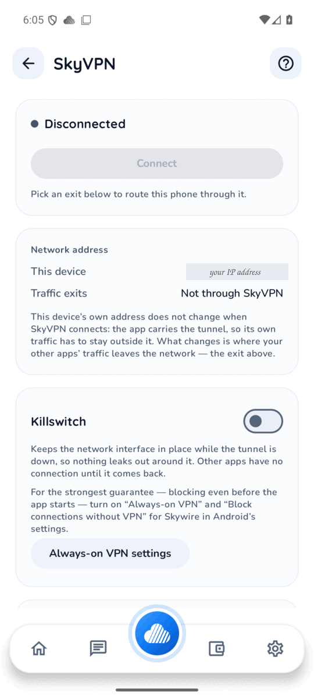

Pick an exit in the list at the bottom of the screen, then press **Connect**.
Android asks once to allow Skywire to set up a VPN.

**Network address** shows the phone's own public address, and where its
traffic leaves the network while SkyVPN is on. The phone's own address does
not change; other apps' traffic leaves through the exit.

**Killswitch** keeps other apps off the network while the tunnel is down, so
nothing leaks around it. For blocking even before the app starts, turn on
Always-on VPN and Block connections without VPN for Skywire in Android's
settings; **Always-on VPN settings** opens them.

 

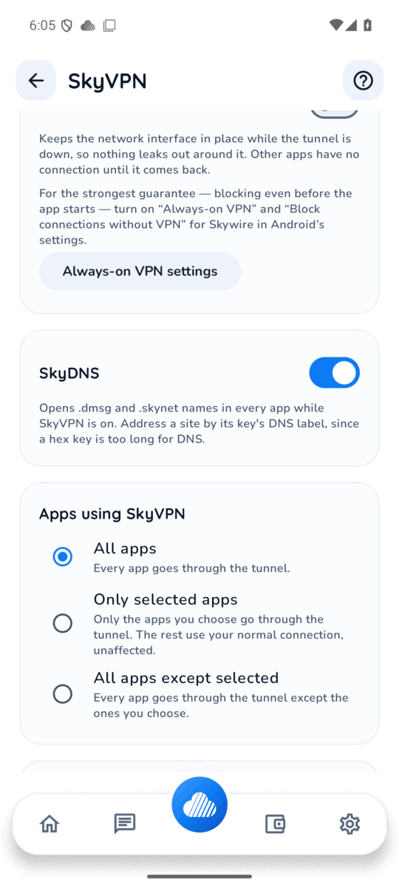

**SkyDNS** inside SkyVPN is on by default: while SkyVPN is connected, every
app can open .dmsg and .skynet names. See [SkyDNS](#skydns) below.

**Apps using SkyVPN** chooses which apps go through the tunnel: all of them,
only the ones you pick, or all except the ones you pick.

 

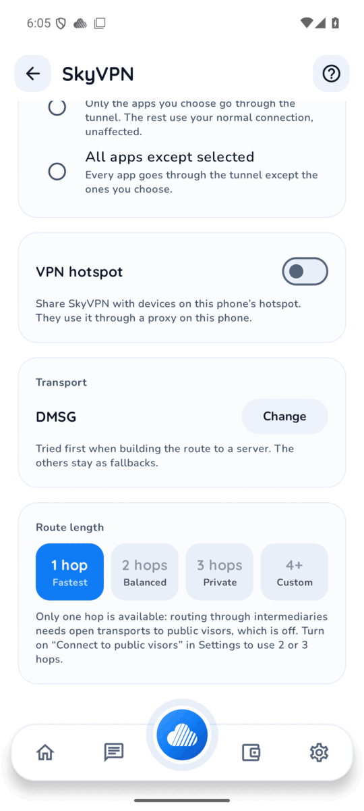

**VPN hotspot** shares SkyVPN with devices connected to this phone's hotspot,
through a proxy on the phone.

**Transport** is the kind of link tried first on the way to the exit; the
others stay as fallbacks.

**Route length** sets how many Skywire visors the traffic passes through
before the exit. One hop is fastest. Two or more need Connect to public visors
turned on in Settings.

 

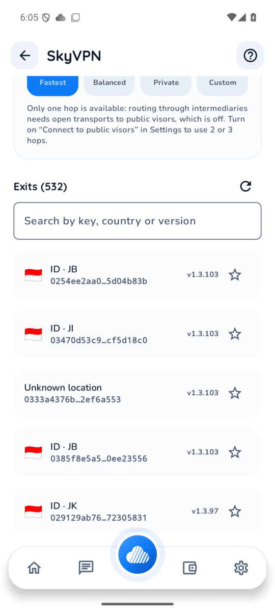

**Exits** lists the public VPN servers with their country and version. Search
by key, country or version, and star the ones you use so they stay at the top.
The refresh button reloads the list.

 

## SkyDNS

SkyDNS lets every app on the phone open .dmsg and .skynet names, such as
`<key>.skynet` sites in the browser. A site is addressed by its key's DNS
label, because a hex public key is too long for a DNS name.

SkyDNS works two ways:

- **Inside SkyVPN.** With SkyVPN connected and its SkyDNS switch on, the
  default, nothing else is needed.
- **On its own.** The SkyDNS switch in the Apps hub runs it while SkyVPN is
  off. Only Skywire's own address range goes into its tunnel, and names that
  are not .dmsg or .skynet are answered by the phone's normal DNS. All other
  traffic goes out as usual, not through Skywire.

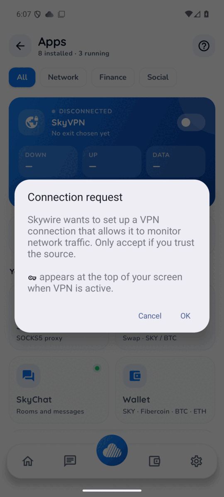

Android lets an app answer DNS for other apps only through a VPN, so the first
time you turn SkyDNS on by itself Android asks to allow a VPN connection.
Press **OK**.

 

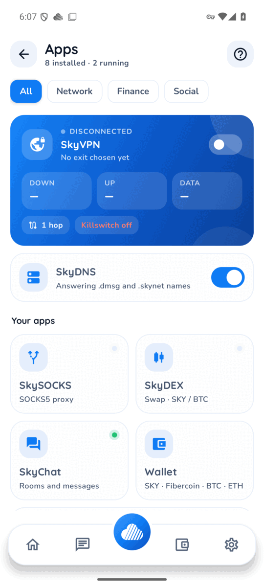

The card then reads **Answering .dmsg and .skynet names**, and the VPN key icon
shows in the status bar.

Two Android limits apply. Only one VPN app can be active at a time, so SkyDNS
on its own cannot run alongside another VPN app. And if Private DNS is set to a
specific provider in Android's network settings, apps may ask that provider
instead of SkyDNS.

 

## SkyChat

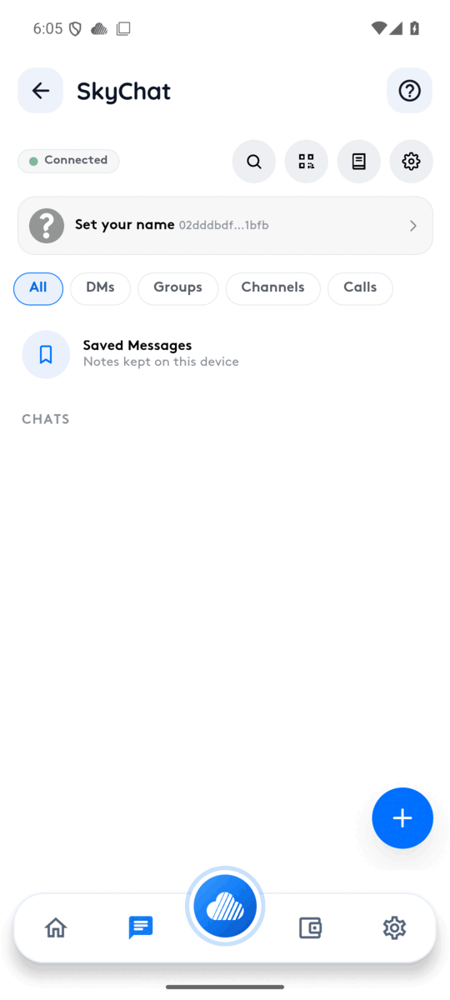

SkyChat is end-to-end encrypted messaging, groups, channels, voice calls and
file sharing, carried peer to peer over Skywire with no central chat server.
Your chat identity is the visor's key.

**Set your name** gives it a display name. The **+** button starts a chat; the
QR button shows your key as a code for someone to scan, or scans theirs.
**Saved Messages** is a notebook kept on the phone. The chips filter chats by
kind.

 

## Wallet

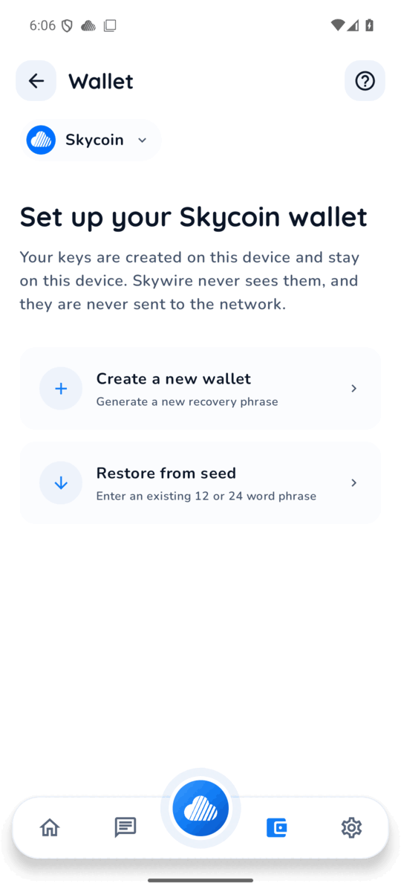

The wallet holds Skycoin, other Fiber coins, Bitcoin, Ethereum and Tether, and
ERC-20 tokens you add. Choose the coin at the top, then **Create a new wallet**
for a new recovery phrase or **Restore from seed** with an existing 12 or 24
word phrase. Keys are made and kept on the phone and are never sent to the
network.

Write the recovery phrase down when you create a wallet. It is the only way to
get the wallet back on another phone.

 

## SkySOCKS and SkyDEX

**SkySOCKS** runs a SOCKS5 proxy on the phone through a public Skywire proxy
server, for apps that let you set a proxy.

**SkyDEX** trades on the Skywire decentralized exchange.

Both open from the Apps hub.

## Settings

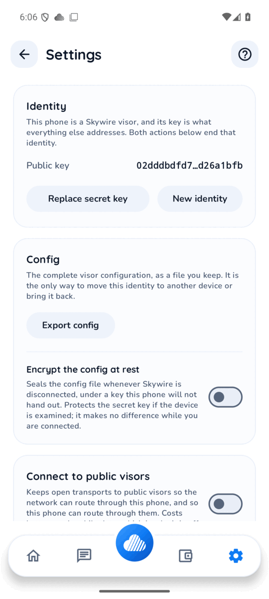

**Identity** shows the visor's public key. **Replace secret key** brings in a
key from another device; **New identity** makes a fresh one. Both end the
current identity.

**Export config** saves the whole visor configuration as a file. It is the
only way to move this identity to another phone or bring it back, so keep it
somewhere safe: it holds the secret key.

**Encrypt the config at rest** seals that file while Skywire is disconnected,
under a key the phone does not hand out.

 

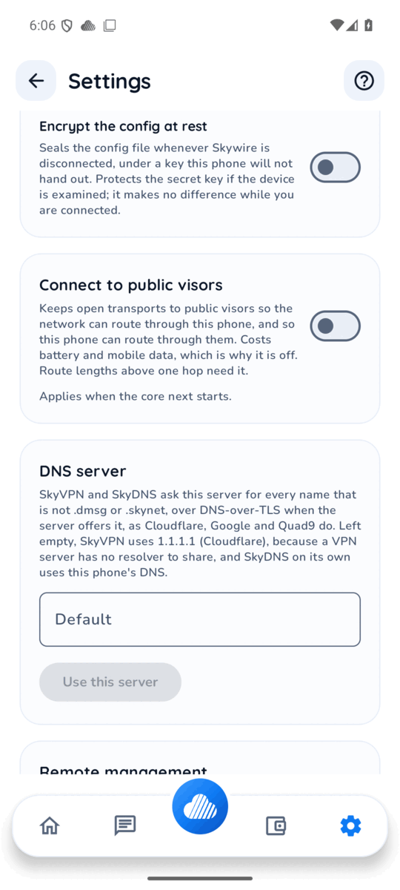

**Connect to public visors** keeps transports open to public visors, so
traffic can route through this phone and it can route through them. It costs
battery and mobile data, which is why it is off. Route lengths above one hop
need it.

**DNS server** is the resolver SkyVPN and SkyDNS use for ordinary names, over
DNS-over-TLS where the server offers it. Left empty, SkyVPN uses 1.1.1.1 and
SkyDNS on its own uses the phone's DNS.

 

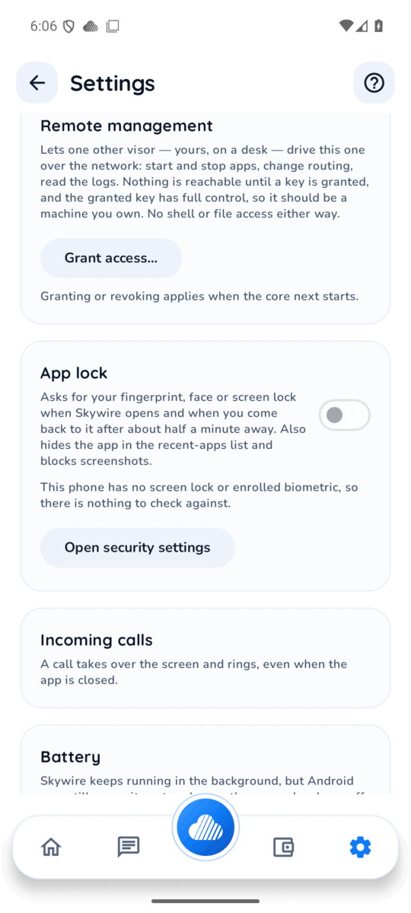

**Remote management** lets one other visor, for example a Skywire hypervisor on
your desktop, manage this phone: start and stop apps, change routing and read
logs. Nothing is reachable until you grant a key, and that key gets full
control, so only grant one for a machine you own.

**App lock** asks for your fingerprint, face or screen lock when Skywire opens.
It needs a screen lock set on the phone.

**Incoming calls** lets a SkyChat call take over the screen and ring, and
**Battery** shows whether Android may pause the app in the background.

 

## When something does not work

- Open **View logs** on the home screen. The core's log usually says what went
  wrong.
- If messages or calls arrive late, allow Skywire to ignore battery
  optimisation (home screen prompt, or Settings, Battery).
- If .skynet names do not open, check SkyDNS is on, and that Private DNS in
  Android's network settings is not set to a specific provider.
- Questions are welcome in the [@skywire](https://t.me/skywire) Telegram
  group.
