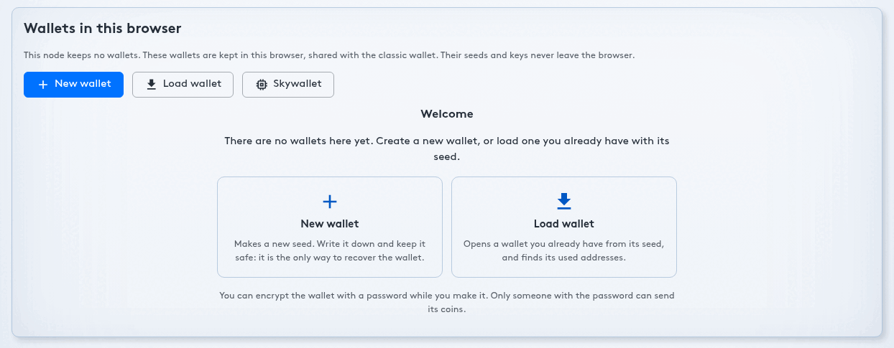
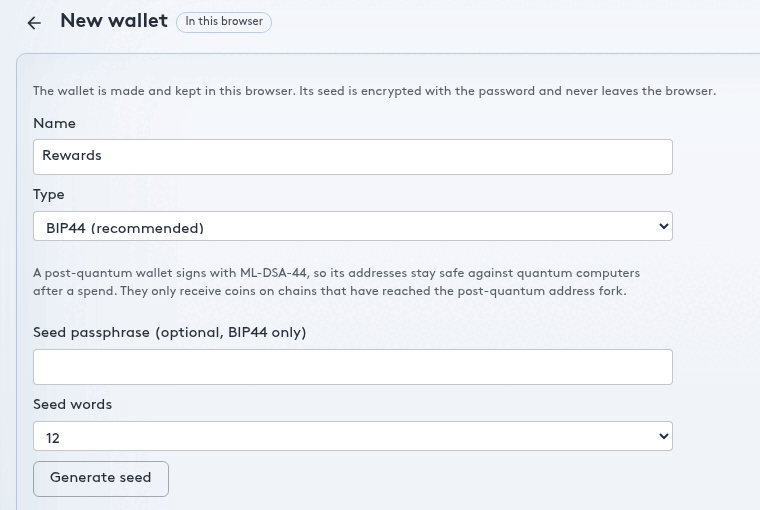
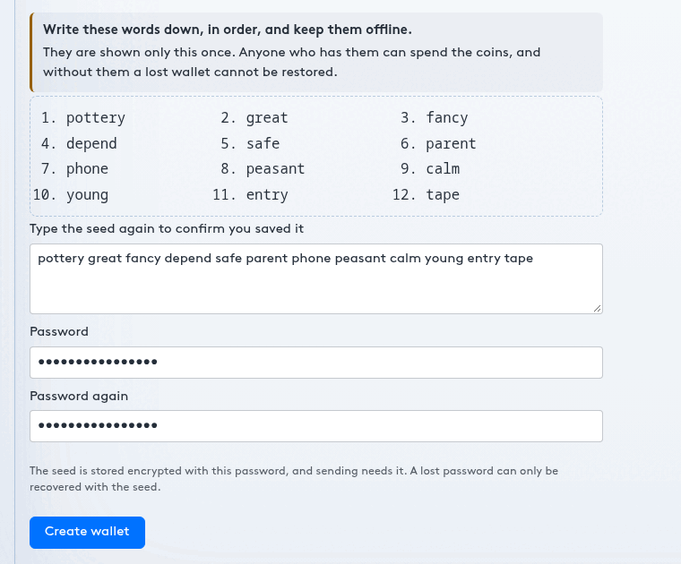
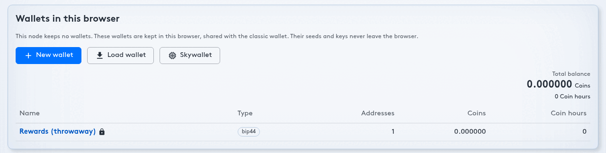
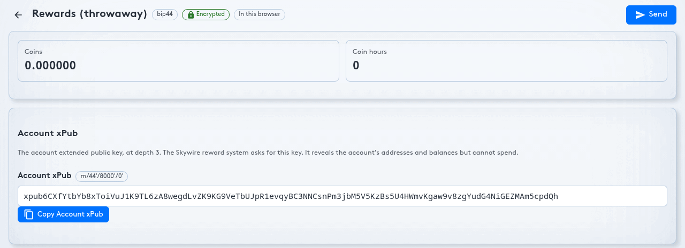

# Get a reward xpub from the wallet page

This is the short, picture by picture way to make a Skycoin wallet and set
it as your visor's reward address. It uses only the wallet web page that
comes with Skywire. [reward-xpub.md](reward-xpub.md) has the details and the
command line way.

The screenshots come from a throwaway wallet made for this guide. Its seed is
shown in them on purpose. Never show your own seed to anyone.

## What you need to know first

**The xpub.** A Skycoin wallet of the BIP44 type has an *account xpub*, a long
key that starts with `xpub`. The reward system turns it into a new address of
your wallet for every reward day, so no address is used twice. Rewards are
paid to an xpub by default.

**Why not a single address.** Since November 15, 2026 a single address that
has sent coins earns no rewards. An xpub does not have that problem.

**What the xpub cannot do.** It cannot spend coins. It does show every
address of the wallet account and so its whole balance and history. Give it
only to the reward system, through your visor. Do not paste it in a chat, a
forum or a public post.

**The seed** is the list of 12 words. Anyone who has it can take the coins.
Write it on paper and keep it offline. Do not photograph it, and do not keep
it in a file, an email or a chat.

**The password** encrypts the wallet kept in your browser. Sending coins
needs it. A lost password can only be replaced by loading the wallet again
from the seed.

## 1. Install Skywire

If Skywire is not installed yet, the
[install command generator](https://deb.theskywirenetwork.net/generator/)
gives you the install command for Linux, Windows or macOS.

## 2. Open the wallet page

Start the wallet page in a terminal and leave the terminal open. The page
works only while it runs.

On Linux:

```
skywire skycoin web
```

On Windows, open PowerShell and run:

```
& "C:\Program Files\Skywire\skywire.exe" skycoin web
```

Then open <http://127.0.0.1:8001> in your browser. On Skywire v1.3.108 to
v1.3.110 open <http://127.0.0.1:8001/ui2/> instead. Older versions need an
update first.

Use exactly `http://127.0.0.1:8001`, every time. The wallet is kept in the
browser under that address, so `localhost` or another browser shows no wallet.



Press **New wallet**.

## 3. Fill in the form

Give the wallet a name, for example *Rewards*. Leave **Type** on
**BIP44 (recommended)**. Only BIP44 wallets have an account xpub.

Leave **Seed passphrase** empty. If you do set one, the wallet cannot be
restored without it, so it must be kept with the seed.

Press **Generate seed**.



## 4. Write down the seed

The 12 words appear. Write them on paper, in order. They are shown only this
once.

Type the words again in the box under them to confirm you wrote them down.
Choose a password, type it twice, and press **Create wallet**.



## 5. Copy the account xpub

The wallet opens by itself. Later you find it in the list on the first page,
with a lock that shows it is encrypted.



The wallet page shows **Account xPub** with the path `m/44'/8000'/0'`. Press
**Copy Account xPub**. The password is not needed for this.



Copy this one only. The classic wallet and some other wallets also show an
xPub for the *External chain* (`m/44'/8000'/0'/0`). That one is wrong and the
visor refuses it.

To check a key, run `skywire skycoin cli verifyXpub <xpub>`. The account xpub
says `depth=3`.

## 6. Set it on your visor

On the computer that runs the visor:

```
skywire cli reward <paste the xpub here>
```

On Windows use `& "C:\Program Files\Skywire\skywire.exe" cli reward <xpub>`
in PowerShell.

The command prints the first five addresses that rewards will go to. The
first one must be the address the wallet page lists as **Receive #0**. If it
is not, the wrong xpub was set.

You can do the same in the hypervisor UI at <http://127.0.0.1:8000>. Open your
visor, find **Rewards**, press **Set address** or **Change address** and paste
the xpub. For several visors at once use **Change rewards address** in the
visor list menu.

On a Linux package install also set it in `/etc/skywire.conf` as
`REWARDSKYADDR`, so that the next config update keeps it. The
[mainnet rules](https://github.com/skycoin/skywire/blob/develop/rewards/mainnet_rules.md#Skycoin-Address)
show how.

Now you can stop the wallet page with Ctrl+C in its terminal. Start it again
whenever you want to see the rewards arrive.
